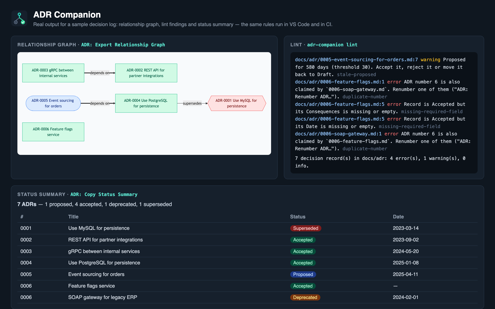

# ADR Companion for VS Code

[](https://marketplace.visualstudio.com/items?itemName=JakubJirak.adr-companion)
[](https://github.com/JirakJ/vscode-adr-companion/actions/workflows/ci.yml)
[](LICENSE)

Write, link and govern **Architecture Decision Records** without leaving the editor — and enforce
the same rules in CI with a single-file CLI. Open source (Apache-2.0) by Jakub Jirák. No account,
no telemetry, zero runtime dependencies.



## Features

### Create
- **New ADR from a template** — Nygard (Classic), MADR, RFC, Y-Statement, Tyree & Akerman, or your
  own Custom template with `{{number}}`, `{{number:0000}}`, `{{title}}`, `{{date}}`, `{{status}}`.
  Numbering is automatic and keeps your existing zero padding (`0007-use-kafka.md`).
- **ADR from a merged pull request** — pick a merge commit (`git log --merges`) or paste a copied PR
  description; Context / Decision / Consequences are extracted from its sections, the PR number and
  a readable title are detected (GitHub, GitLab and squash-merge subjects).

### Browse and navigate
- **Architecture Decisions view** in the Explorer: grouped by status, as a **timeline** by month, or
  as a flat list; tooltips show status, date, successor and context.
- **Go to ADR** — fuzzy pick by number, title or words from the context.
- **Code ↔ ADR links** — `@adr:0007`, `@adr-7`, `@adr#7` or `@ADR(7)` in any language becomes a link
  with a hover card; `@adr:` completion lists every decision (outdated ones last, struck through).
- **Link Code to ADR** (`Cmd/Ctrl+Alt+A`) inserts the annotation in the current language's comment
  syntax. **Find Code References** lists every place a decision is cited, or tells you it is an orphan.

### Lifecycle
- **Change Status** — Draft → Proposed → Accepted → Deprecated / Superseded / Rejected, with
  non-standard transitions labelled. Front matter and the `## Status` section are updated together.
- **Supersede links both ways** — choosing *Superseded* asks for the successor, writes
  `Superseded by [ADR-0012](0012-….md)` and adds `Supersedes ADR-0007` (and `supersedes: [7]` in front
  matter) to the successor.
- **Safe renumbering** — change a number and the file name, title heading, front matter and every
  `ADR-7` / `@adr:007` / Markdown link across the folder are rewritten, each keeping its own padding.
  This is how you fix two branches that both created `ADR-0007`.

### Lint diagnostics (Problems panel, live while you type)
| Rule | Severity |
|------|----------|
| Accepted record without Decision, Consequences or Date | error |
| Superseded record without a successor; successor that does not exist | error |
| Two records claiming the same number | error |
| Rejected record without any rationale | error |
| Proposed for longer than `maxProposedAgeDays` | warning |
| Unknown / missing status, invalid date, conflicting numbers (file vs heading vs front matter) | warning |
| Accepted record still containing template placeholder text | warning |
| `@adr:NNN` in code pointing at a missing ADR / at a deprecated or superseded one | warning / info |
| Accepted record older than `stalenessThresholdDays` (opt-in review reminder) | info |

### Share
- **Copy Status Summary** — a Markdown badge, status breakdown and table for a README or PR.
- **Generate Index** — `index.md` in the ADR directory as one table or grouped by status or year.
- **Export Relationship Graph** — Mermaid (renders on GitHub, GitLab, Confluence, Backstage) or
  Graphviz DOT; supersedes / amends / depends-on / related edges; optional clustering by status.

### Govern
- **Team configuration** — a committed `.adr-config.yaml` overrides personal settings key by key.
  The format is shared with the ADR Companion plugin for JetBrains IDEs.
- **Governance check** — list architecturally significant globs under `requireAdrForPaths`; when a
  change touches them without adding or updating an ADR, **ADR: Check Governance** warns in the editor
  and `adr-companion governance` fails the pull request.

## Getting started

1. Run **ADR: Create New ADR…** from the Command Palette (or the `+` in the Architecture Decisions view).
   Records are found in `doc/adr`, `docs/adr`, `adr`, `docs/decisions` or `docs/architecture/decisions`;
   the first ADR goes to `docs/adr` unless you configure another directory.
2. Optionally run **ADR: Create Team Configuration** to commit a documented `.adr-config.yaml`.
3. Add `// @adr:0001` above the code a decision governs.

## Team configuration — `.adr-config.yaml`

```yaml
directory: docs/adr
defaultFormat: MADR          # NYGARD | MADR | RFC | Y_STATEMENT | TYREE_AKERMAN | CUSTOM
maxProposedAgeDays: 30
stalenessThresholdDays: 180
customTemplatePath: docs/adr/.adr-template.md

# Changing a matching file without an ADR fails the governance check.
requireAdrForPaths:
  - "**/api/**"
  - "**/*.proto"
  - db/migrations/**
```

`**` crosses directories, `*` and `?` stay within one. Unknown keys and bad values become warnings on
the file itself — a malformed config never stops the extension from finding your decisions.

## CI: the `adr-companion` CLI

Every [release](https://github.com/JirakJ/vscode-adr-companion/releases) ships
`adr-companion-cli.cjs`, a single dependency-free file that runs with Node 18+. **ADR: Create GitHub
Actions Governance Workflow** writes this for you:

```yaml
- uses: actions/checkout@v4
  with: { fetch-depth: 0 }
- run: curl -fsSL -o adr.cjs https://github.com/JirakJ/vscode-adr-companion/releases/download/v1.0.0/adr-companion-cli.cjs
- run: node adr.cjs lint --format github        # findings appear on the PR diff
- run: node adr.cjs governance --format github  # uses origin/$GITHUB_BASE_REF as the base
```

```
adr-companion lint        [--format text|json|github] [--fail-on error|warning|info|never]
adr-companion governance  [--base <ref>] [--head <ref>] [--files a,b] [--format text|github] [--warn-only]
adr-companion graph       [--format mermaid|dot] [--direction TD|LR] [--cluster] [--out <file>]
adr-companion index       [--group none|status|year] [--out <file>]
adr-companion summary
common:                   [--root <repo>] [--dir <adr directory>]
```

Exit codes: `0` ok, `1` findings at or above the threshold / governance violation, `2` runtime error,
`64` usage error. Git is always run via `execFile` with an argument array, never through a shell.

## Settings

| Setting | Default | Description |
|---------|---------|-------------|
| `adrCompanion.directory` | *(auto)* | ADR directory relative to the workspace folder |
| `adrCompanion.defaultFormat` | `nygard` | Template preselected for new records |
| `adrCompanion.customTemplatePath` | *(empty)* | Template for the Custom format |
| `adrCompanion.maxProposedAgeDays` | `30` | Stale-proposal threshold |
| `adrCompanion.stalenessThresholdDays` | `0` | Review reminder for old accepted records (0 = off) |
| `adrCompanion.requireAdrForPaths` | `[]` | Globs that need an ADR when changed |
| `adrCompanion.governance.baseRef` | *(auto)* | Base for the governance check (`origin/HEAD`, then `main`/`master`) |
| `adrCompanion.view.mode` | `status` | `status`, `timeline` or `flat` |
| `adrCompanion.lint.enabled` | `true` | Lint diagnostics on decision records |
| `adrCompanion.referenceCheck.enabled` | `true` | Check `@adr` annotations in code |
| `adrCompanion.statusBar.enabled` | `true` | ADR count in the status bar |

Keys present in `.adr-config.yaml` take precedence over these settings.

## Workspace trust

In an untrusted workspace you can browse, lint and edit records; commands that run git (ADR from
merged PR, governance check) and the custom template path are disabled until you trust the folder.

## Development

```bash
npm ci
npm run lint && npm run typecheck && npm test
npm run vsix            # builds dist/ and packages the extension
npm run icon            # regenerates media/icon.png
npm run screenshot      # regenerates media/screenshot.png from real CLI output (needs Chrome)
```

Everything under `src/core` is pure TypeScript without the VS Code API, so the editor and the CLI share
one implementation. This repository records its own decisions in [`docs/adr`](docs/adr).

## License

[Apache-2.0](LICENSE) © 2026 Jakub Jirák
